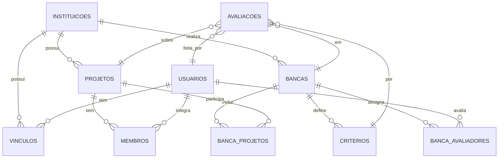

# Modelo de dados (DER) — PostgreSQL (Supabase)

Restrições: `UNIQUE(usuario, instituicao, papel)` em vínculos; `UNIQUE(banca, projeto, avaliador, criterio)` em avaliações (impede nota duplicada);
`CHECK(nota BETWEEN 1 AND 5)`; `CHECK(peso > 0)`. Índices em `projetos(instituicao_id, ano, semestre)` e `avaliacoes(banca_id, projeto_id)`.
O identificador da instituição está em vínculos, projetos e bancas; os demais dados herdam o escopo por essas tabelas.
